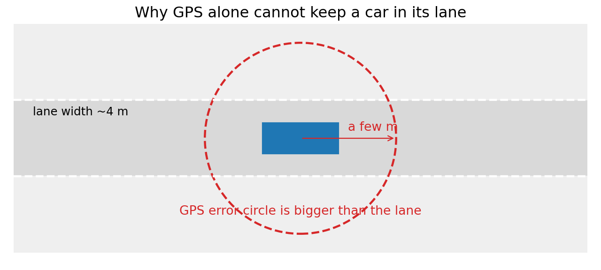
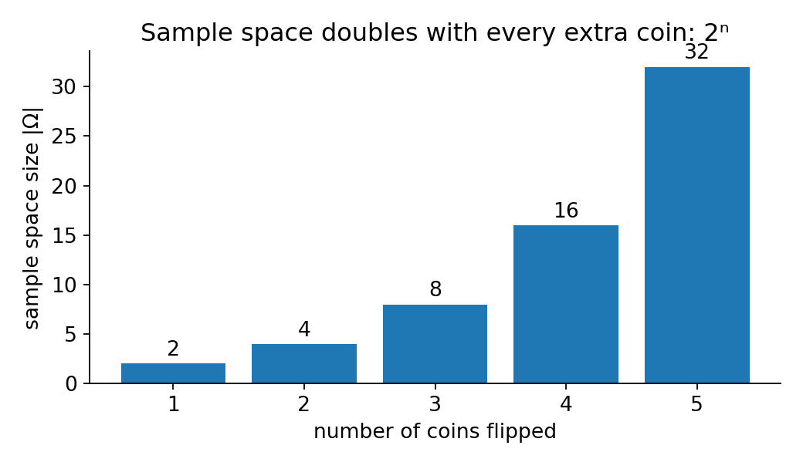
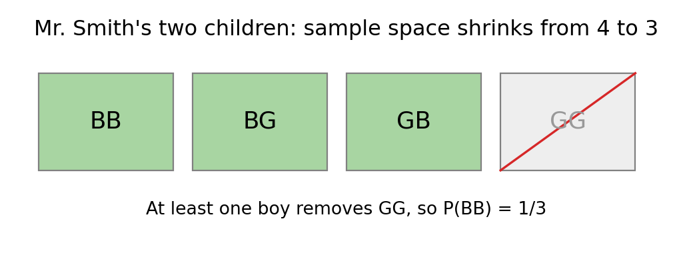
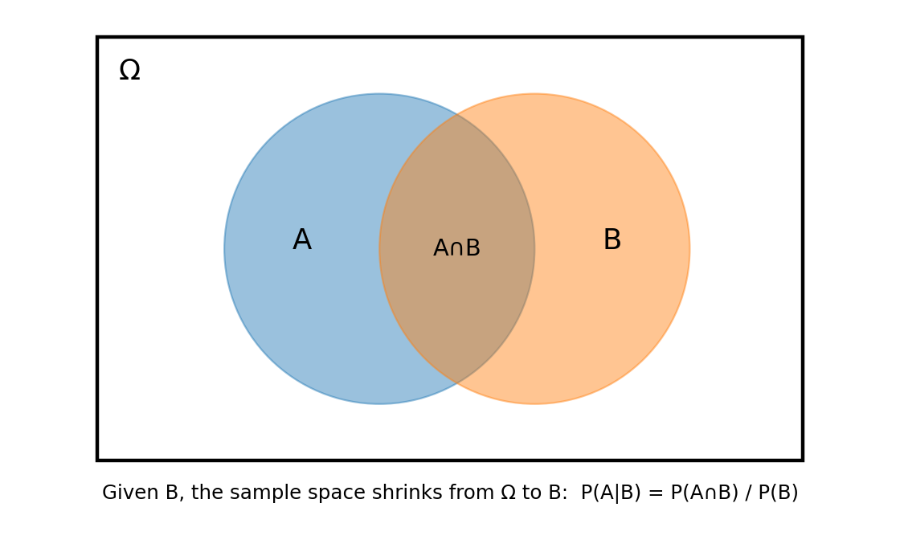
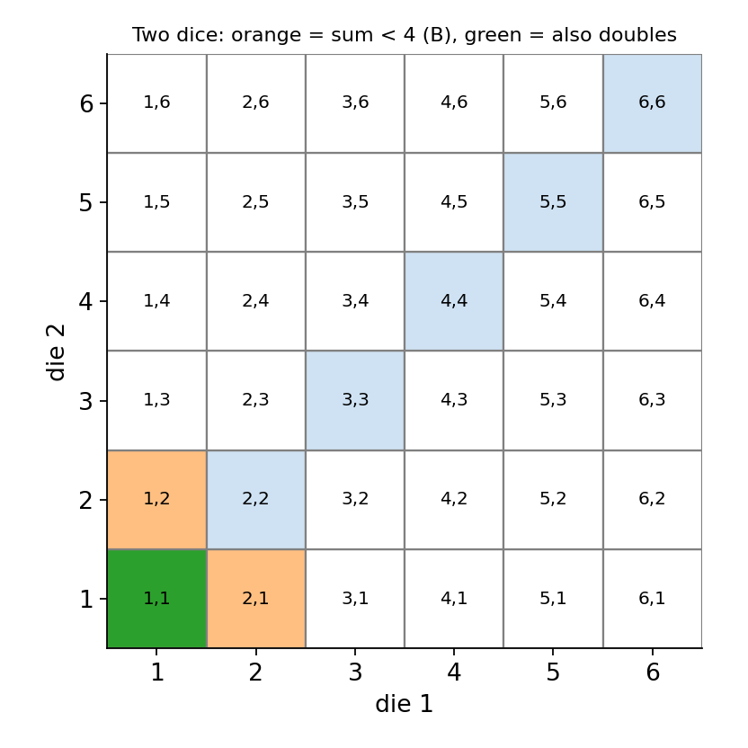
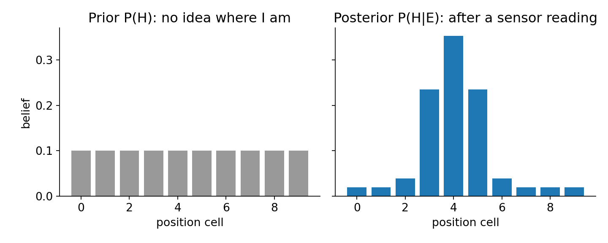

# 01. Localization and probability basics

Notes from the opening section of *Bayesian Algorithms for Self-Driving Cars* (edX), covering localization, probability spaces, conditional probability, and the Bayesian view of probability.

**Contents**

1. [Localization](#1-localization)
2. [Probability spaces](#2-probability-spaces)
3. [Conditional probability](#3-conditional-probability)
4. [Bayesian thinking](#4-bayesian-thinking)
5. [Summary](#5-summary)
6. [Open items](#6-open-items)

---

## 1. Localization

### Concept

Localization means finding a position. The question behind the whole topic is whether a car can know where it is with high precision.

GPS is the usual answer, but it has two limits:

- It needs a clear sky, so it fails in malls, tunnels, and underground parking lots.
- Its accuracy is limited to a few meters. A lane is about 4 m wide, so GPS alone cannot keep a self-driving car in its lane.



### Global and local localization

| Type | Starting knowledge | Question it answers |
|---|---|---|
| Global localization | The map, nothing else (complete uncertainty) | Where am I? |
| Local localization | The map and my exact current position | Where will I be at the next step? |

The course covers both.

### Stochastic and deterministic

Nothing in the real world is fully certain. Sensors are accurate but not perfectly accurate. Engine commands ("move 10 m forward") are executed accurately but not perfectly. So the car works with a random component at every step and has to decide its position with high enough probability instead of certainty.

### Application to autonomous driving

Every method in this repo (histogram, Kalman, and particle filters, sensor fusion) exists to turn noisy sensor and motion data into a position estimate that is good enough to drive on.

---

## 2. Probability spaces

### Concept

A probability space has three parts:

| Symbol | Name | Meaning |
|---|---|---|
| Ω | Sample space | All possible outcomes |
| F (Σ) | Set of events | Subsets of Ω |
| P | Probability | A number assigned to each event |

The question it answers: given a sample space Ω, what is the probability P of an event A?

### Math

$$P(A) = \frac{\text{number of outcomes in } A}{\text{number of outcomes in } \Omega} = \frac{|A|}{|\Omega|}$$

Unit measure: the probability that something in the sample space happens is 1.

$$P(\Omega) = 1$$

The lecture writes this as "P(Σ) = 1". It is the same statement: the whole event set covers every outcome.

Frequentist definition: repeat the experiment N times and count how often A occurs.

$$P(A) = \lim_{N \to \infty} \frac{N_A}{N}$$

### Worked example 1: the sample space changes with the experiment

One coin: Ω = {H, T}, size 2.
Two coins: Ω = {HH, HT, TH, TT}, size 4.
n coins: size 2ⁿ. For 4 coins that is 16, the same count as the 4-bit binary numbers 0000 to 1111.



### Worked example 2: a fair die

Ω = {1, 2, 3, 4, 5, 6}.

- A = "even number" = {2, 4, 6}, so P(A) = 3/6 = 1/2.
- B = "roll a 7" = {}, so P(B) = 0 because 7 is not in Ω.

### Worked example 3: Mr. Smith's children

Mr. Smith has two children and at least one is a boy. What is the probability that both are boys?

The tempting answer is 1/2. It is wrong because the sample space is the list of ordered pairs, not the single unknown child.

1. Full sample space: {BB, BG, GB, GG}, size 4.
2. "At least one boy" removes GG, leaving {BB, BG, GB}, size 3.
3. Only BB satisfies the question, so P = 1/3.



The lesson is the same as in the coin example: get the sample space right before counting.

### Application to autonomous driving

The "sample space" of a localizing car is the set of positions it could be in. Each sensor reading removes some of them, which is the idea behind conditional probability below.

---

## 3. Conditional probability

### Concept

Conditional probability is the probability of an event given that another event has already happened. It is the core tool of localization: *what is the probability of being at this position, given where I was a moment ago?*

### Math

$$P(A \mid B) = \frac{P(A \cap B)}{P(B)}$$

Why it works: if B is known to have occurred, Ω is no longer the sample space. The sample space shrinks to B, so we count the part of A that lies inside B (the intersection) and divide by B.



### Worked example: two dice

Roll two dice. What is the probability both show the same number (A), given that the sum is less than 4 (B)?

**Intuitive route**

1. Sums below 4: (1,1), (1,2), (2,1). Even (2,2) has sum 4, so it is out.
2. The reduced sample space has 3 equally likely outcomes.
3. Only (1,1) is a double.
4. P(A | B) = 1/3.

**Formula route**

1. P(B) = 3/36 = 1/12
2. P(A ∩ B) = 1/36, because (1,1) is the only outcome in both A and B
3. P(A | B) = (1/36) / (1/12) = 12/36 = 1/3

Both routes give 1/3.



### Code check

```python
from itertools import product

omega = list(product(range(1, 7), repeat=2))
B = [o for o in omega if sum(o) < 4]
A_and_B = [o for o in B if o[0] == o[1]]

print(len(A_and_B) / len(B))  # 0.333...
```

### Application to autonomous driving

Replace B with "the sensor reading I just got" and A with "I am in cell x". The same shrinking of the sample space is what a histogram filter does at every update.

---

## 4. Bayesian thinking

### Two meanings of probability

| | Frequentist | Bayesian |
|---|---|---|
| Meaning | Long-run frequency of repeated trials | Degree of belief |
| Works for | Dice, coins, cards | One-off events (an election, where my car is) |
| Depends on the observer | No | Yes |

The math is identical in both views. Only the interpretation changes.

In the Bayesian reading, P = 1 means I am certain the event occurs, P = 0 means I am certain it does not, and P = 0.5 means I have no idea.

### Bayes' theorem

The usual form:

$$P(A \mid B) = \frac{P(B \mid A)\, P(A)}{P(B)}$$

The lecturer relabels A as H (hypothesis) and B as E (evidence):

$$P(H \mid E) = \frac{P(E \mid H)\, P(H)}{P(E)}$$

| Term | Name | In a self-driving car |
|---|---|---|
| P(H) | Prior | Where I believe the car is before the new reading |
| E | Evidence | Data from the sensors |
| P(E \| H) | Likelihood | How likely this reading is if the car were at H |
| P(H \| E) | Posterior | Updated belief after the reading |

If P(H | E) = P(H), then H and E are independent: no evidence ever changes the belief.

### Why it matters

Bayes' theorem gives two things:

1. A way to put a number on a belief.
2. A rule for changing that belief when new data arrives.

### Illustrative example

This figure is my own toy example, not from the lecture. The car starts with a uniform prior over 10 position cells. A sensor reading that fits cells 3 to 5 best is multiplied in, and the result is normalized.



Multiply the prior by the likelihood cell by cell, then divide by the total so the beliefs sum to 1. This multiply-and-normalize step is the update half of the histogram filter.

---

## 5. Summary

| Idea | Formula | One-line use |
|---|---|---|
| Probability of an event | P(A) = \|A\| / \|Ω\| | Count outcomes in a correct sample space |
| Unit measure | P(Ω) = 1 | Beliefs over all positions sum to 1 |
| Conditional probability | P(A\|B) = P(A∩B) / P(B) | Shrink the sample space to what is known |
| Bayes' theorem | P(H\|E) = P(E\|H) P(H) / P(E) | Update a position belief from a sensor reading |

## 6. Open items

- The lecture lists "Total probability" as a topic but the transcript has no content for it yet. Add it once the video notes are available, since it supplies the P(E) in the denominator of Bayes' theorem.
- Next: probabilistic representations (histograms and distributions), then Bayesian inference applied to the first 1D localization example.

## Source

*Bayesian Algorithms for Self-Driving Cars*, edX. Course materials belong to their creators. The explanations, figures, and code here are my own.
